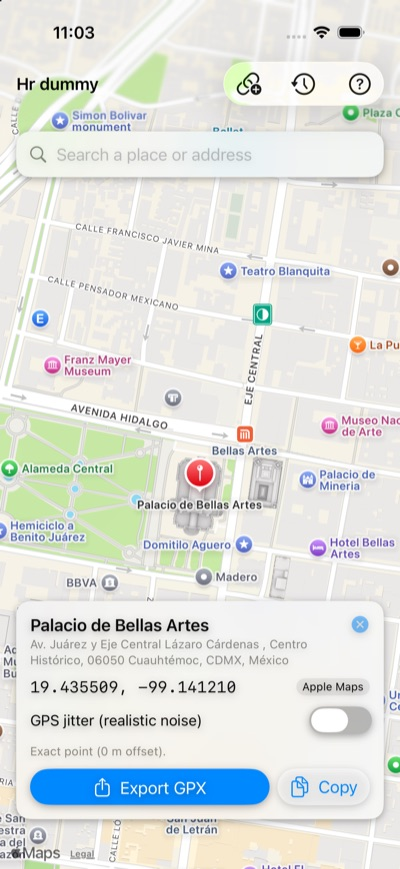
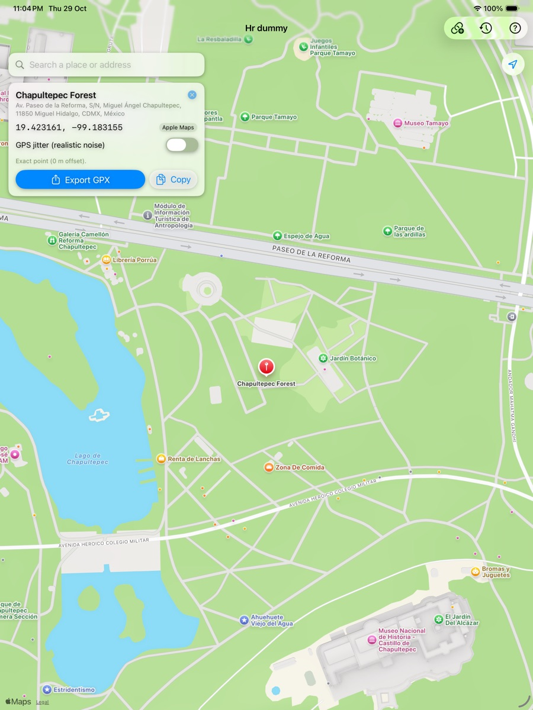

<p align="center">
  
</p>

<h1 align="center">Hr dummy</h1>

<p align="center"><b>Be anywhere. Without going anywhere.</b><br>
A laid-back iPhone & iPad sidekick for simulating locations: find a place, drop a pin, export a GPX, done.</p>

## What's the vibe
Need your phone to "be" in Mexico City, Paris, or that taco spot around the corner? Hr dummy finds the exact coordinate and hands it to Apple's own location-simulation tools (Xcode, `simctl`, or `pymobiledevice3`). No jailbreak, no sketchy tweaks, no stress.

> **Why GPX and not "change the GPS" from the app?** iOS doesn't let apps change the location the rest of the system sees (only jailbreak tweaks can, and the App Store says no). Apple's supported way is developer location simulation, and Hr dummy is the chill front end for it: it picks the spot and gives you the file or command.

## What it does
A SwiftUI app for iPhone and iPad (iOS/iPadOS 17+). Find the spot, fine-tune it, ship it as a GPX. Every screenshot below comes from the iOS 26.5 Simulator.

<table>
  <tr>
    <td width="55%">
      <b>Search by name</b><br>
      Type a place or address and pick a result. Uses Apple Maps by default (no key needed), or <b>Google Places API (New)</b> for Google Maps names when <code>GOOGLE_PLACES_API_KEY</code> is set. Nearby and worldwide results are mixed, so "Palacio de Bellas Artes" finds the one in CDMX even if the map is in San Francisco.
    </td>
    <td align="center"></td>
  </tr>
  <tr>
    <td>
      <b>See the spot</b><br>
      The place card shows the name, full address, exact coordinates (6 decimals, ≈0.1 m) and where the result came from. Export the GPX or copy the coordinates, GPX, <code>simctl</code> or <code>pymobiledevice3</code> command.
    </td>
    <td align="center"></td>
  </tr>
  <tr>
    <td>
      <b>Accurate within 20 m, with optional wobble</b><br>
      Turn on <b>GPS jitter</b> for realistic noise: choose a radius of 1–20 m (hard cap at 20 m) and how many points to generate (one every 5 s). Leave it off to get the exact point.
    </td>
    <td align="center"></td>
  </tr>
  <tr>
    <td>
      <b>How to apply, built in</b><br>
      The <b>?</b> button explains how to apply the location on a physical device (Xcode), in the iOS Simulator (<code>simctl</code>), or on a device without Xcode (<code>pymobiledevice3</code>), using the current coordinates.
    </td>
    <td align="center"></td>
  </tr>
</table>

**Drop a pin (iPad):** tap anywhere on the map and get the street address back. On iPad everything lives in a side panel, so the map gets the full screen.

<p align="center"></p>

**Search on iPad:** same flow as the iPhone, but the results and the place card stay in the side panel while you look around the map.

<p align="center"></p>

Also in the box:
- **Paste it in:** `lat, lon`, Google Maps URLs (`/place/…!3d…!4d…`, `@lat,lon`, `?q=`, `?query=`) or `maps.app.goo.gl` short links (link button, top right).
- **Remembers stuff:** history of recent spots (clock button).
- **Takes it with you:** GPX export through the share sheet (AirDrop, Files…).

## Quick start
```bash
brew install xcodegen
cp Config/Secrets.example.xcconfig Config/Secrets.xcconfig   # optional: Google key + team ID
make open                                                    # generates and opens LocationSimulator.xcodeproj
```
Requirements: Xcode 15+ (iOS 17 SDK), iOS/iPadOS 17+. The Xcode project, scheme and bundle id still say `LocationSimulator`; only the name on the home screen changed.

## Teleport time
| Where | How |
| --- | --- |
| Physical device (every app sees it) | Replace `GPX/CurrentLocation.gpx` with the exported file and run the app from Xcode on the device. Switch any time via **Debug ▸ Simulate Location**. |
| iOS Simulator | `scripts/simulate-location.sh simulator 19.432608 -99.133209` (or `--gpx file.gpx`). With several simulators booted, pick one: `SIM_DEVICE=<udid or name> scripts/simulate-location.sh …` |
| Physical device, no Xcode session (iOS 17+) | `sudo pymobiledevice3 remote tunneld`, then `scripts/simulate-location.sh device --gpx file.gpx` |

Full workflow: [docs/WORKFLOW.md](docs/WORKFLOW.md). Test plan and cases: [docs/TEST_CASES.md](docs/TEST_CASES.md).

## What's inside
```
App/                      SwiftUI app (views, view model, Apple/Google search, history, export, app icon)
Packages/LocationSimCore/ Platform-independent core: geo math, GPX, link parsing, Google Places client (+ tests, run on Linux too)
Tests/                    App unit tests and XCUITests (iPhone + iPad)
GPX/CurrentLocation.gpx   Default location applied by the scheme when running from Xcode
docs/                     Workflow, test cases, screenshots
scripts/                  simulate-location.sh, pick-simulator.sh
project.yml               XcodeGen spec (project file is generated, not committed)
```

## Tests
```bash
make core-test     # core package (macOS or Linux)
make test-iphone   # unit + UI tests on an iPhone simulator
make test-ipad     # unit + UI tests on an iPad simulator
```
CI (`.github/workflows/ci.yml`) runs all three on every push and PR.
