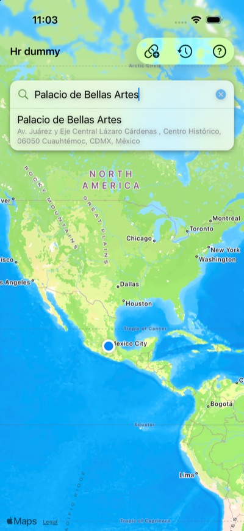
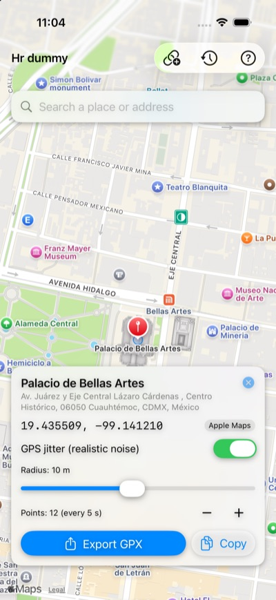
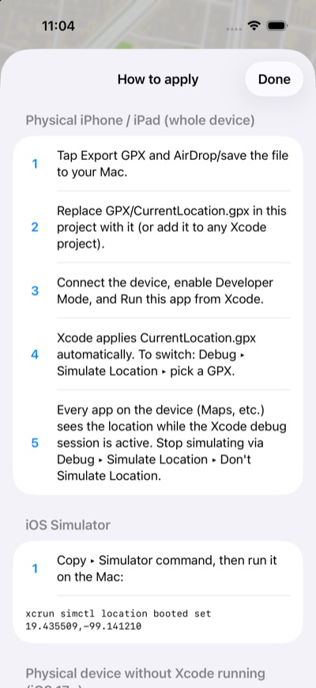
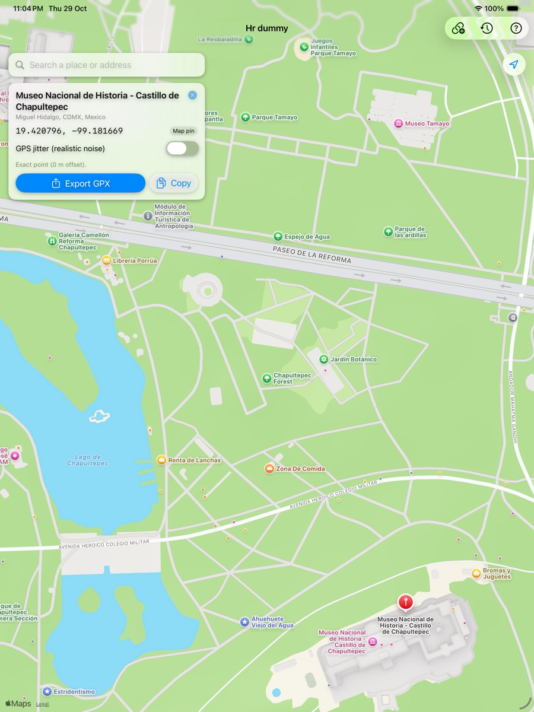

<p align="center">
  
</p>

<h1 align="center">Hr dummy</h1>

<p align="center"><b>Be anywhere. Without going anywhere.</b><br>
A laid-back iPhone & iPad sidekick for simulating locations: find a place, drop a pin, export a GPX, done.</p>

<p align="center">
  
  
  
</p>
<p align="center">
  
</p>

## What's the vibe
Need your phone to "be" in Mexico City, Paris, or that taco spot around the corner? Hr dummy finds the exact coordinate and hands it to Apple's own location-simulation tools (Xcode, `simctl`, or `pymobiledevice3`). No jailbreak, no sketchy tweaks, no stress.

> **Why GPX and not "change the GPS" from the app?** iOS doesn't let apps change the location the rest of the system sees (only jailbreak tweaks can, and the App Store says no). Apple's supported way is developer location simulation, and Hr dummy is the chill front end for it: it picks the spot and gives you the file or command.

## What it does
- **Search by name:** places and addresses via Apple Maps (no key needed), or **Google Places API (New)** for Google Maps names when `GOOGLE_PLACES_API_KEY` is set.
- **Drop a pin:** tap anywhere on the map and get the street address back.
- **Paste it in:** `lat, lon`, Google Maps URLs (`/place/…!3d…!4d…`, `@lat,lon`, `?q=`, `?query=`) or `maps.app.goo.gl` short links.
- **Accurate within 20 m:** coordinates use 6 decimals (≈0.1 m). Optional **GPS jitter** adds realistic noise, keeping every point within 1–20 m (hard cap at 20 m).
- **Take it with you:** export a GPX (AirDrop, Files…) or copy the coordinates, GPX, `simctl` or `pymobiledevice3` command.
- **Remembers stuff:** history of recent spots.
- **Fits the screen:** bottom card on iPhone, side panel on iPad.

## Quick start
```bash
brew install xcodegen
cp Config/Secrets.example.xcconfig Config/Secrets.xcconfig   # optional: Google key + team ID
make open                                                    # generates and opens LocationSimulator.xcodeproj
```
Requirements: Xcode 15+ (iOS 17 SDK), iOS/iPadOS 17+. The Xcode project, scheme and bundle id still say `LocationSimulator`; only the name on the home screen changed.

## Teleport time
| Where | How |
| --- | --- |
| Physical device (every app sees it) | Replace `GPX/CurrentLocation.gpx` with the exported file and run the app from Xcode on the device. Switch any time via **Debug ▸ Simulate Location**. |
| iOS Simulator | `scripts/simulate-location.sh simulator 19.432608 -99.133209` (or `--gpx file.gpx`). With several simulators booted, pick one: `SIM_DEVICE=<udid or name> scripts/simulate-location.sh …` |
| Physical device, no Xcode session (iOS 17+) | `sudo pymobiledevice3 remote tunneld`, then `scripts/simulate-location.sh device --gpx file.gpx` |

Full workflow: [docs/WORKFLOW.md](docs/WORKFLOW.md). Test plan and cases: [docs/TEST_CASES.md](docs/TEST_CASES.md).

## What's inside
```
App/                      SwiftUI app (views, view model, Apple/Google search, history, export, app icon)
Packages/LocationSimCore/ Platform-independent core: geo math, GPX, link parsing, Google Places client (+ tests, run on Linux too)
Tests/                    App unit tests and XCUITests (iPhone + iPad)
GPX/CurrentLocation.gpx   Default location applied by the scheme when running from Xcode
docs/                     Workflow, test cases, screenshots
scripts/                  simulate-location.sh, pick-simulator.sh
project.yml               XcodeGen spec (project file is generated, not committed)
```

## Tests
```bash
make core-test     # core package (macOS or Linux)
make test-iphone   # unit + UI tests on an iPhone simulator
make test-ipad     # unit + UI tests on an iPad simulator
```
CI (`.github/workflows/ci.yml`) runs all three on every push and PR.
