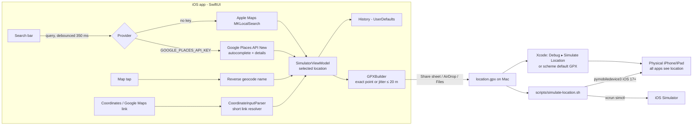

# Workflow

## 1. Architecture



`LocationSimCore` (Swift package) holds all logic that does not need UIKit/MapKit: coordinates and haversine math, uniform random points within a radius, GPX build/parse, Google Maps URL parsing, Google Places client and the shell command builders. It is unit-tested on macOS and Linux.

## 2. One-time setup (Mac)
1. Install Xcode 15+ and XcodeGen: `brew install xcodegen`.
2. Optional — Google Maps names:
   1. In Google Cloud, enable **Places API (New)** and create an API key.
   2. Restrict it to iOS apps with bundle ID `com.jafcas.LocationSimulator` (the app sends `X-Ios-Bundle-Identifier`) and to Places API (New).
   3. `cp Config/Secrets.example.xcconfig Config/Secrets.xcconfig` and set `GOOGLE_PLACES_API_KEY`.
   Without a key the app uses Apple Maps search, which needs no setup.
3. For a physical device set `DEVELOPMENT_TEAM` in `Config/Secrets.xcconfig` (or pick the team in Xcode ▸ Signing).
4. `make open` (runs `xcodegen generate` and opens the project).
5. On the iPhone/iPad: Settings ▸ Privacy & Security ▸ **Developer Mode** ▸ On (iOS 16+), then trust the Mac when connecting by cable.

## 3. Choosing a location in the app
| Method | Steps | Result name / source |
| --- | --- | --- |
| By name | Type ≥ 2 characters in the search bar ▸ tap a result. Switch Apple Maps / Google Places with the globe button (only shown when a Google key is configured). Results are biased to the visible map area. | Place name (`Apple Maps` / `Google Places`) |
| Map pin | Tap anywhere on the map. Tap again to move it. | Reverse-geocoded name, or "Dropped Pin" (`Map pin`) |
| Coordinates | Toolbar link button ▸ `19.432608, -99.133209` ▸ **Use** | "Custom Coordinates" |
| Google Maps link | In Google Maps ▸ Share ▸ Copy link ▸ paste in the same sheet ▸ **Use**. Place links use the exact pin (`!3d…!4d…`), not the viewport center. Short links are resolved over the network. | "Google Maps Link" |

The selection card shows the name, the coordinate (6 decimals) and the source. Recent selections are kept in **History** (max 25, same spot within 1 m is de-duplicated).

### Accuracy (≤ 20 m)
- The selected coordinate is the provider's place coordinate, written with 6 decimals (≈ 0.11 m). With jitter off, the device reports that exact point — well within 20 m.
- **GPS jitter** (optional) exports a timestamped series of points (every 5 s) randomly and uniformly distributed inside a disk of radius 1–20 m around the target. The radius is clamped to 20 m in code (`GeoMath.maxAccuracyRadius`), so no exported point can be farther than 20 m.
- Note: geocoders place a POI at a representative point. For large places (parks, airports) the desired spot may differ from the geocoder's point; drop a pin or paste coordinates to be exact.

## 4. Applying the location

### A. Physical device via Xcode (recommended — all apps see it)
1. Tap **Export GPX** ▸ AirDrop to the Mac (or Save to Files ▸ iCloud Drive).
2. Replace `GPX/CurrentLocation.gpx` with the exported file (keep the name), or drag the file into the Xcode project navigator.
3. Select your device as run destination and press **Run**. The scheme has *Allow Location Simulation* on with `GPX/CurrentLocation.gpx` as default, so the location is applied at launch.
4. Switch location while running: **Debug ▸ Simulate Location ▸ <GPX>** (or the location arrow in the debug bar).
5. Open Maps or any other app: it reports the simulated location.
6. Stop: **Debug ▸ Simulate Location ▸ Don't Simulate Location**, or stop the debug session. Restarting the device always restores real GPS.

### B. iOS Simulator
```bash
scripts/simulate-location.sh simulator 19.432608 -99.133209   # or: Copy ▸ Simulator command
scripts/simulate-location.sh simulator --gpx Zocalo.gpx       # jitter GPX plays as a 5 s route
scripts/simulate-location.sh simulator clear
```

### C. Physical device without an Xcode session (iOS 17+)
```bash
pip3 install pymobiledevice3
sudo pymobiledevice3 remote tunneld            # keep running in another terminal
scripts/simulate-location.sh device --gpx Zocalo.gpx
scripts/simulate-location.sh device clear
```
For iOS ≤ 16 use `pymobiledevice3 developer simulate-location set -- <lat> <lon>` after mounting the developer disk image. Check `pymobiledevice3 --help` if your version's syntax differs.

## 5. Development workflow
1. Change code ▸ `make core-test` for core logic (fast, also works on Linux).
2. `make test-iphone` and `make test-ipad` run unit + UI tests on simulators. UI tests launch the app with `-uiTesting`, which swaps in offline mock search/geocoding and an isolated history store, so they are deterministic and need no network or location permission.
3. Push / open a PR: GitHub Actions runs the same three suites (`core` on Linux, `ios` matrix iPhone + iPad on macOS).

## 6. Troubleshooting
| Symptom | Fix |
| --- | --- |
| "Google Places error 403" | Places API (New) not enabled, key restriction mismatch (bundle ID), or billing not enabled. |
| No globe button | `GOOGLE_PLACES_API_KEY` is empty — check `Config/Secrets.xcconfig`, then re-run `xcodegen generate`. |
| Simulate Location menu is greyed out | The app must be running from Xcode in a debug session; scheme ▸ Run ▸ Options ▸ *Allow Location Simulation* must be checked. |
| Location reverts | Simulation lasts only while the Xcode debug session (or `tunneld` + pymobiledevice3) is active. |
| Short link fails | Requires network; in some regions Google redirects to a consent page — open the link in a browser and paste the full URL instead. |
